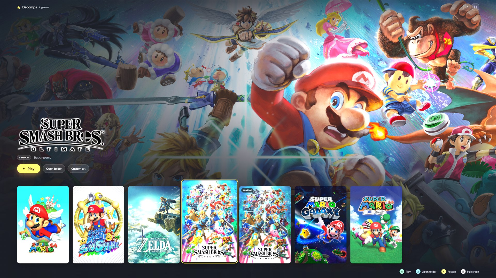
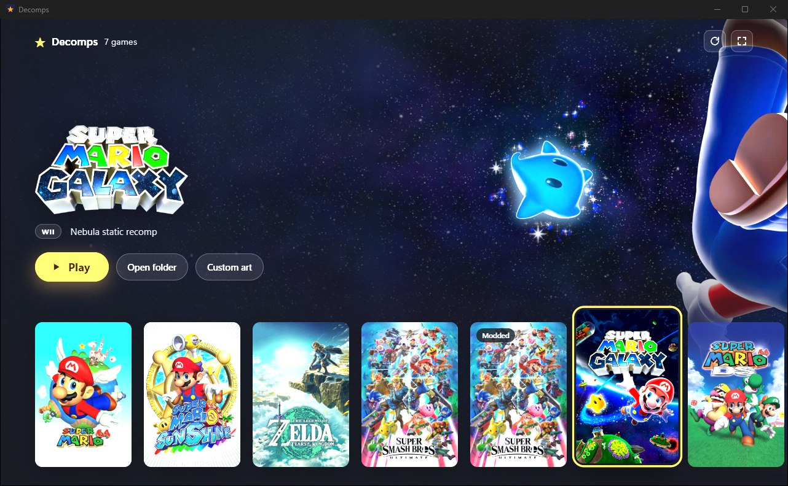
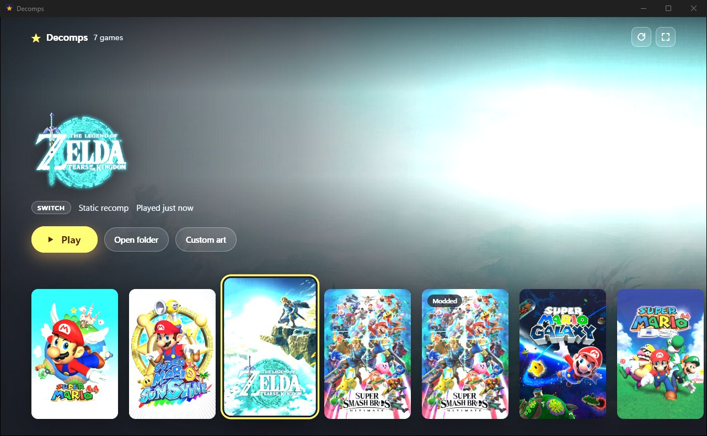
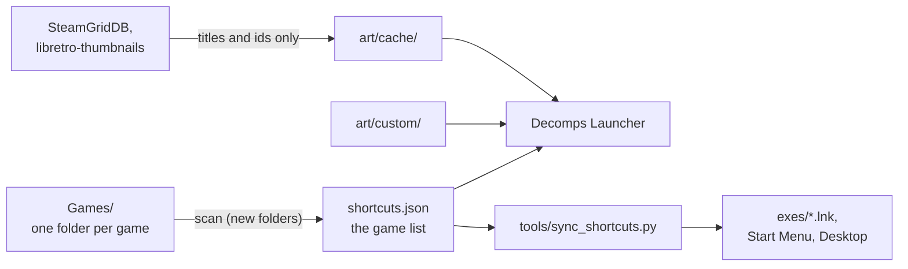

# Decomps

A personal Windows workspace for Nintendo decompilations, static recompilations and PC ports, with **Decomps Launcher**, a small desktop app that shows every game with cover art and launches it from one place. It works in a window with a mouse or fullscreen with a controller.



| Windowed library | Selected game |
|---|---|
|  |  |

> **No games are included.** This repo holds the launcher and the glue around it. Each game lives in its own folder under `Games/` (ignored by git), built from its own project and your own legally obtained copy. Not affiliated with or endorsed by Nintendo.

## Features

- **One library for every port.** Decomp ports, static recomps and installed apps all show up as tiles, whatever they launch with (`.exe` or a `.bat` wrapper).
- **Finds games for you.** Drop a game folder into `Games/` and the launcher picks the right executable, skipping installers, settings apps and build tools.
- **Art downloaded and cached automatically.** Box art, a wide backdrop and a logo for each game come from [SteamGridDB](https://www.steamgriddb.com/), falling back to [libretro-thumbnails](https://github.com/libretro-thumbnails/libretro-thumbnails) (the art RetroArch uses). You can override any image by dropping in your own.
- **Couch mode.** Fullscreen and fully controller-driven. The launcher minimizes while a game runs and comes back when the game exits.
- **Play history.** Last played and total playtime per game.
- **Windows shortcuts stay in sync.** The same game list generates `.lnk` launchers and repairs Start Menu and Desktop shortcuts after folders move.
- **Small and native.** One ~11 MB exe ([Tauri](https://tauri.app/) + WebView2) with the UI embedded.

## Games in this workspace

| Game | Original platform | Port |
|---|---|---|
| Super Mario 64 | Nintendo 64 | [sm64ex-alo](https://github.com/AloUltraExt/sm64ex-alo) PC port |
| Super Mario Sunshine | GameCube | PC port of the decomp |
| The Legend of Zelda: Tears of the Kingdom | Switch | Static recomp |
| Super Smash Bros. Ultimate (and a modded variant) | Switch | Static recomp |
| Super Mario Galaxy | Wii | [Nebula](https://github.com/keepvaibin/nebula) static recomp |
| Super Mario 64 DS | Nintendo DS | SM64DS Port |

## How it fits together



`shortcuts.json` is the single list of games. The launcher appends entries for new folders it finds, you polish them by hand once (title, platform), and both the launcher and the shortcut tool read from it.

## Getting started

### Requirements

- Windows 10 or 11 with the WebView2 runtime (preinstalled on current Windows)
- [Rust](https://rustup.rs/) with the MSVC toolchain, and Visual Studio 2022 Build Tools (the "Desktop development with C++" workload)
- Python 3, only for `tools/sync_shortcuts.py`

### Build

```powershell
git clone git@github.com:michaelyang12/decomps.git Decomps
cd Decomps\launcher
cargo build --release
```

The exe is written to `launcher\target\release\decomps-launcher.exe`. It finds the workspace by walking up from its own folder, so it can be run straight from there, or from a Start Menu shortcut that points at it.

### Command line

| Flag | Effect |
|---|---|
| `--root <dir>` | Use another workspace folder (also `DECOMPS_ROOT`) |
| `--fullscreen` | Start in couch mode (otherwise it reopens in the last mode used) |
| `--scan` | Add new game folders to `shortcuts.json`, write `art/cache/scan.log`, exit |
| `--fetch-art` | Refetch all art, write `art/cache/fetch.log`, exit |

## Adding a game

1. Put the game's folder in `Games/`.
2. Open the launcher, or press its refresh button. It adds an entry to `shortcuts.json` and shows the game. The launch target is guessed in this order:
   1. `Play*.bat` / `Play*.cmd` scripts, one tile each (`Play X (modded)` becomes a "Modded" variant tile)
   2. an exe named like the folder
   3. the largest exe that isn't an installer, uninstaller, settings app or build tool

   Version folders (`versions/1.0.2/`) become `*`, so updates keep working.
3. Give the entry a proper title, platform and art lookup:

   ```json
   {"name": "Nebula", "target": "Games/Nebula/versions/*/Nebula.exe", "title": "Super Mario Galaxy", "platform": "Wii", "port": "Nebula static recomp", "art": {"libretro": "Super Mario Galaxy (USA)", "steamgriddb": 36389}}
   ```

4. Optionally, run `python3 tools/sync_shortcuts.py --external` to create its `.lnk` launcher.

A wrong guess is fixed by editing `target`; scans never change existing entries. Folders that aren't games go in the top-level `"ignore"` list, and more library folders go in `"scan"`. See [AGENTS.md](AGENTS.md#manifest-shortcutsjson) for every field.

## Art

| Source | Gives | Needs |
|---|---|---|
| SteamGridDB | cover, backdrop, logo | a free API key (steamgriddb.com, Preferences, API) in `.env` as `STEAMGRIDDB_API_KEY=...` |
| libretro-thumbnails | cover (box scan), backdrop (screenshot) | nothing, but no Switch titles and no logos |
| `art/custom/<title-slug>/` | anything you drop in: `cover.png`, `hero.png`, `logo.png` | the **Custom art** button opens the folder |

Art is fetched in the background and cached in `art/cache/`. Only game titles and ids are sent to these services. `.env` and `art/` are git-ignored. Games with no art get a generated placeholder tile.

## Controls

| Action | Keyboard / mouse | Controller |
|---|---|---|
| Move | ← → (Home / End) | D-pad or left stick (LB / RB jump to the ends) |
| Play | Enter, double-click | A |
| Open the game's folder | **Open folder** | X |
| Rescan and refresh art | F5, refresh button | Y |
| Toggle fullscreen | F11 (Esc leaves it) | Start |

Controller input is ignored while the launcher isn't focused, so button presses in a running game never reach it.

## Repository layout

| Path | What |
|---|---|
| `launcher/` | Decomps Launcher: Rust backend (`src/`) and plain HTML/CSS/JS UI (`ui/`) |
| `shortcuts.json` | The game list |
| `tools/sync_shortcuts.py` | Generates `exes/*.lnk` and repairs Start Menu and Desktop shortcuts from the game list |
| `AGENTS.md` | Working notes for the workspace (also read by coding agents) |
| `TODO.md` | Open items |
| `Games/`, `exes/`, `art/`, `.env` | Local only, git-ignored |

## License

[MIT](LICENSE). This covers the launcher and tooling in this repo only; the games, their ports and any downloaded art belong to their respective owners.
